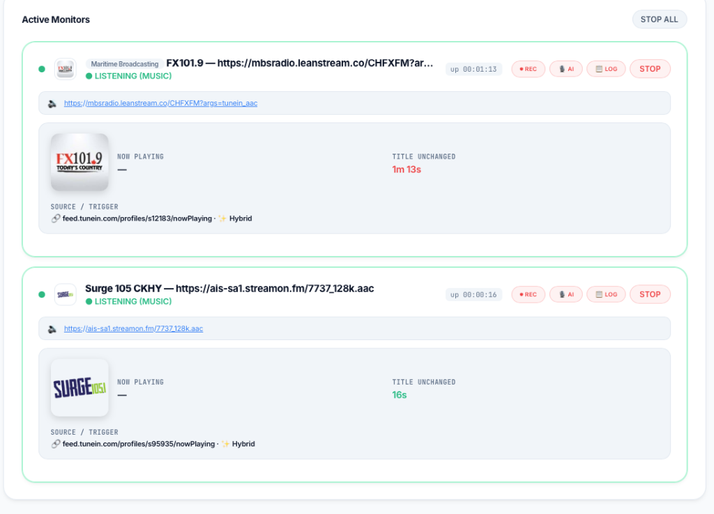
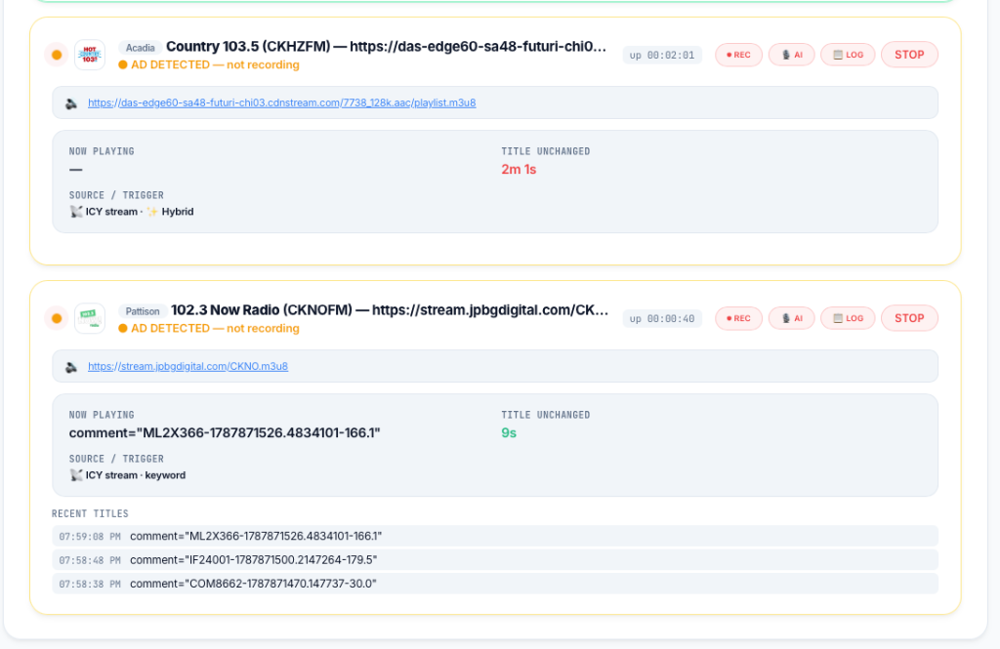
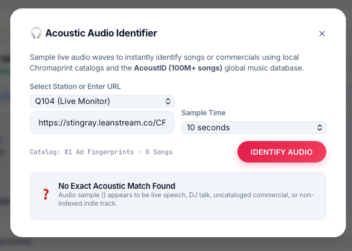
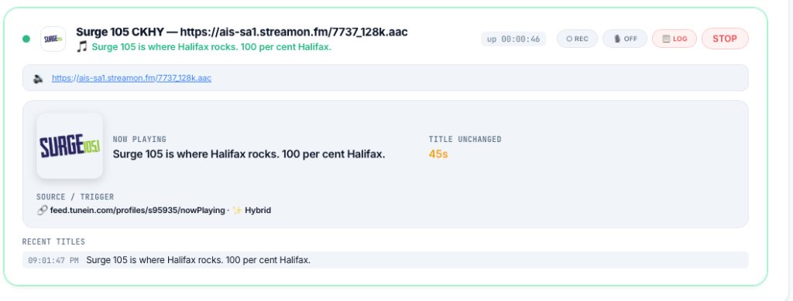
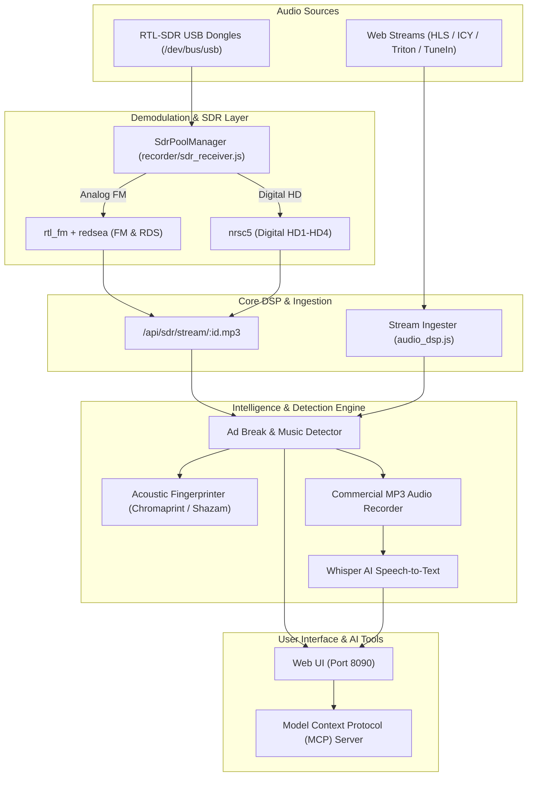

# Stingray BIC 📻⚡

<div align="center">

### Broadcast Intelligence Console · Commercial Detection & AI Audio Platform

[](https://github.com)
[](https://www.docker.com)
[](https://nodejs.org)
[](https://python.org)
[](https://openai.com)
[](https://www.rtl-sdr.com)
[](https://modelcontextprotocol.io)

<br/>



</div>

---

## 🌟 Overview

**Stingray BIC** (Broadcast Intelligence Console) is a high-performance broadcast monitoring and intelligence platform designed to listen to, analyze, record, and transcribe radio broadcasts in real time.

It seamlessly unifies **Web Audio Streams** (HLS, ICY, AAC, MP3, Triton, Corus, Rogers, TuneIn) and **Off-Air RTL-SDR Receivers** (Analog FM with real-time RDS/RBDS and NRSC-5 Digital HD Radio HD1–HD4) with automated ad break boundary detection, acoustic audio fingerprinting, and local OpenAI Whisper AI transcription.

---

## 📸 Visual Tour

<div align="center">

### 1. Live Multi-Station Monitoring & RF Telemetry
*Real-time audio player, metadata tracking, album artwork lookup, stall detection, and 5-bar RF signal level meter.*


---

### 2. Intelligent Commercial Break & Ad Detection
*Multi-signal ad boundary detection using Triton metadata, ICY comment cues, silence/volume drop DSP, and Chromaprint acoustic fingerprints.*



---

### 3. Acoustic Audio Identifier
*Instantly sample live broadcast waves to identify songs or unindexed commercials against Chromaprint catalogs and the AcoustID database.*



---

### 4. Station Metadata & Cue Tracking
*Instant RDS RadioText, now-playing music titles, and time-since-last-change tracking.*



</div>

---

## ⚡ Key Features

### 📻 Off-Air RTL-SDR Demodulation Engine
- **Analog FM Stereo + RDS/RBDS**: Spawns `rtl_fm` piped directly into `redsea` for real-time decoding of Program Service (`PS`), RadioText (`RT`), and RadioText+ (`RT+` Artist / Title).
- **NRSC-5 Digital HD Radio**: Demodulates digital HD subchannels (`HD1` through `HD4`) with live MER (Modulation Error Ratio dB), BER, and broadcast station telemetry.
- **Dedicated 1-Dongle-Per-Station Hardware Architecture**: High-fidelity isolation with physical hardware dongle assignment per station monitor.
- **Multi-Dongle Device Pooling & Auto-Assignment**: Run 2, 3, 4, or more physical RTL-SDR USB sticks concurrently (`-d 0`, `-d 1`, `-d 2`...). Automatic detection picks the next available idle stick seamlessly.
- **Built-in EEPROM Serial Burner**: Program permanent sequential serial numbers (`00000001`, `00000002`...) into dongle EEPROMs using `rtl_eeprom` to prevent USB port renumbering on reboots.
- **5-Bar LED Signal Gauge**: Live visual signal strength meter with color-coding (Emerald Green, Cyan, Amber, Red) and exact dBFS/MER readouts.

### 🎯 Ad Detection & Acoustic Fingerprinting
- **Hybrid Multi-Signal Detection**: Network-specific Triton cue triggers, ICY metadata changes, blank title filters, silence/volume drop detectors.
- **Dual-Fingerprinting**: Hybrid Shazam + Chromaprint music detection that cuts CPU usage by up to 70% during song playback.
- **Automatic Break Recording**: Segments and archives commercial breaks as MP3 files with customizable retention hours and auto-purge.

### 🎙 Automated AI Transcription & Intelligence
- **OpenAI Whisper AI**: Automatically transcribes captured commercial breaks into searchable text with advertiser attribution.
- **Advertiser Analytics**: Track commercial airtime, frequency, and market share across stations and networks.
- **Batch Controls**: 1-click `⏺ REC ALL` and `🎙 AI ALL` controls for managing entire station fleets instantly.

### 🔌 Model Context Protocol (MCP) Server
- Exposes full station control, monitoring, ad logs, and SDR hardware diagnostics to AI agent pair programmers via Model Context Protocol tools.

---

## 🏗 Architecture



---

## 🚀 Getting Started

### Prerequisites
- [Docker](https://docs.docker.com/get-docker/) & [Docker Compose](https://docs.docker.com/compose/)
- *(Optional for Off-Air SDR)*: One or more RTL-SDR USB dongles (RTL2832U, R820T/R820T2/E4000, RTL-SDR v3/v4).

### 1. Clone & Start

```bash
# Clone the repository
git clone https://github.com/your-org/radio-sonar.git
cd radio-sonar

# Start the application
docker-compose up --build -d
```

Open your browser and navigate to **`http://localhost:8090`** (or your Unraid/server IP).

---

### 2. Docker Compose Configuration

```yaml
services:
  recorder:
    build: ./recorder
    restart: unless-stopped
    volumes:
      - ./recorder/server.js:/app/server.js
      - ./recorder/audio_dsp.js:/app/audio_dsp.js
      - ./recorder/transcriber.js:/app/transcriber.js
      - ./recorder/sdr_receiver.js:/app/sdr_receiver.js
      - ./recorder/shazam_recognize.py:/app/shazam_recognize.py
      - ./recorder/mcp_server.js:/app/mcp_server.js
      - recordings:/recordings
      - whisper_cache:/root/.cache/whisper
    devices:
      - /dev/bus/usb:/dev/bus/usb   # USB passthrough for RTL-SDR dongles
    networks:
      - internal

  web:
    build:
      context: .
      dockerfile: web.Dockerfile
    restart: unless-stopped
    ports:
      - "8090:80"
    volumes:
      - ./frontend/index.html:/usr/share/nginx/html/index.html:ro
      - recordings:/usr/share/nginx/html/recordings:ro
    networks:
      - internal

volumes:
  recordings:
  whisper_cache:

networks:
  internal:
```

> [!NOTE]
> **RTL-SDR USB Permissions**: The container automatically blacklists default kernel DVB drivers (`dvb_usb_rtl28xxu`) so `libusb` can claim the receiver dongles with zero host configuration.

---

## 📡 RTL-SDR Hardware Setup

1. **Plug in your RTL-SDR dongle(s)** to your server or a powered USB hub.
2. In Stingray BIC, click **🔧 Tools $\rightarrow$ 📻 RTL-SDR Receiver & Diagnostics**.
3. Click **↻ SCAN DONGLES** to verify device detection.
4. *(Optional)* Click **⚡ AUTO-ASSIGN UNIQUE SERIALS** to burn permanent serial numbers (`00000001`, `00000002`...) into dongle EEPROMs.
5. In the **Stations** tab, select **📻 Off-Air RTL-SDR**, enter your frequency (e.g. `105.1`), and click **ADD STATION**!

---

## 🛠 Model Context Protocol (MCP) Tools

Stingray BIC includes a built-in MCP server for AI pair programmers:

| MCP Tool | Description |
| :--- | :--- |
| `barracuda_sdr_status` | Retrieve status of all connected dongles, tuner state, and RF telemetry |
| `barracuda_sdr_tune` | Programmatically tune an SDR receiver (`freq`, `mode`, `program`, `gain`, `device`) |
| `barracuda_get_status` | Get active station monitors, now playing tracks, ad detection states, and RF meters |
| `barracuda_start_monitor` | Start monitoring an audio stream or off-air frequency |
| `barracuda_stop_monitor` | Stop an active monitor |
| `barracuda_list_stations` | List all saved stations and presets |
| `barracuda_get_recordings` | List captured commercial MP3 recordings and Whisper AI transcripts |

---

## 📄 License

This project is licensed under the MIT License — see the [LICENSE](LICENSE) file for details.
